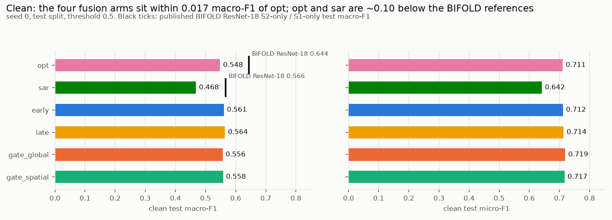
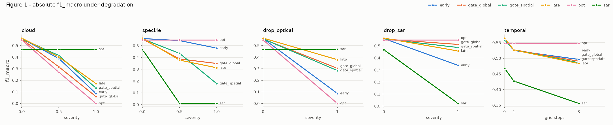
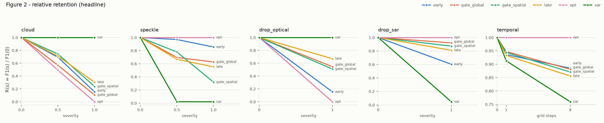
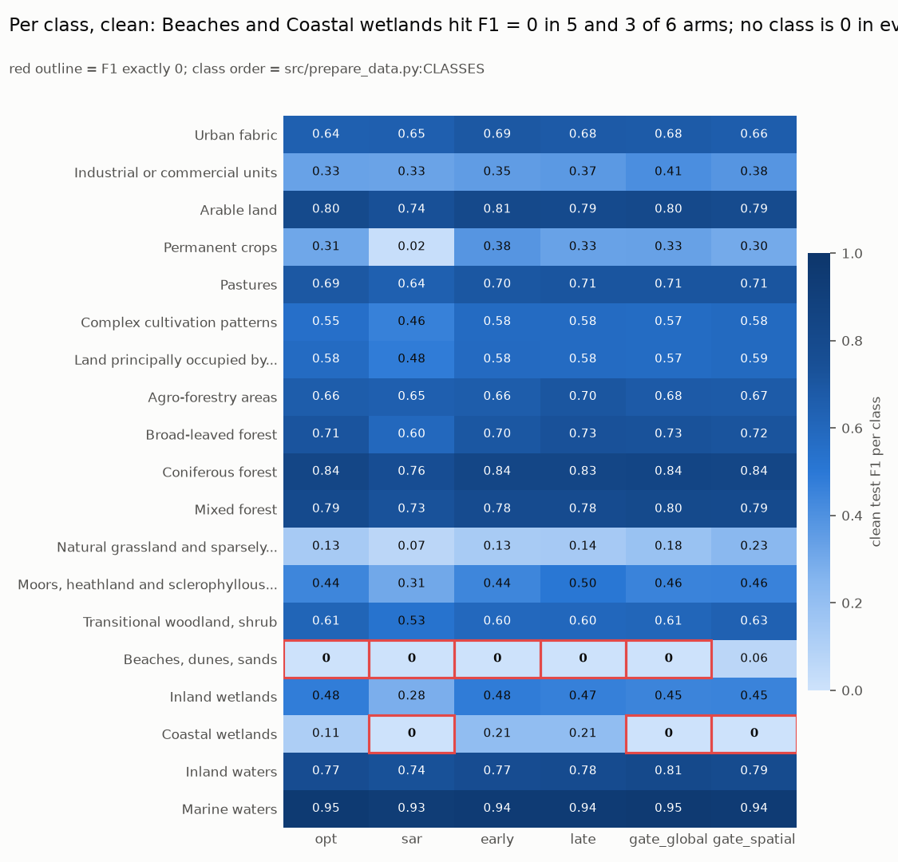
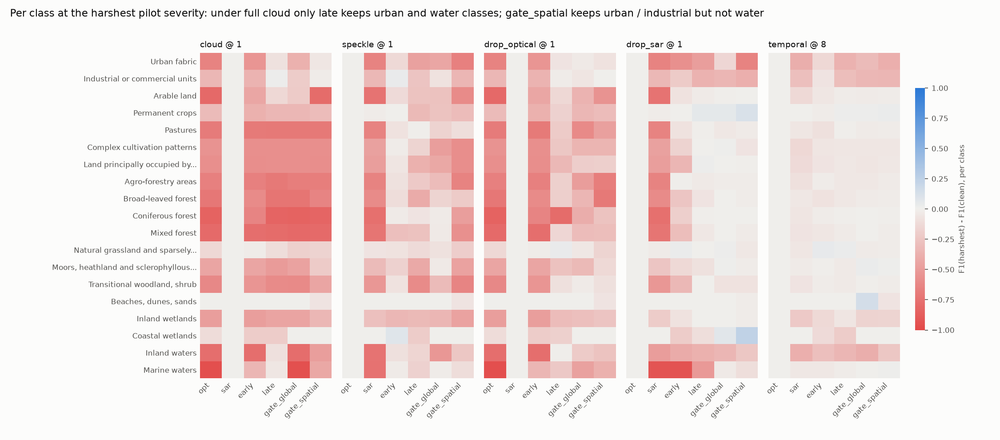
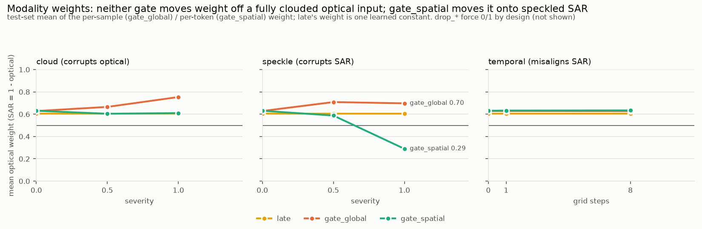
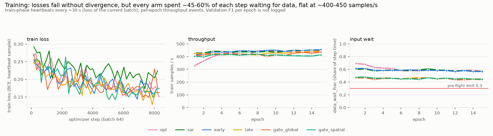
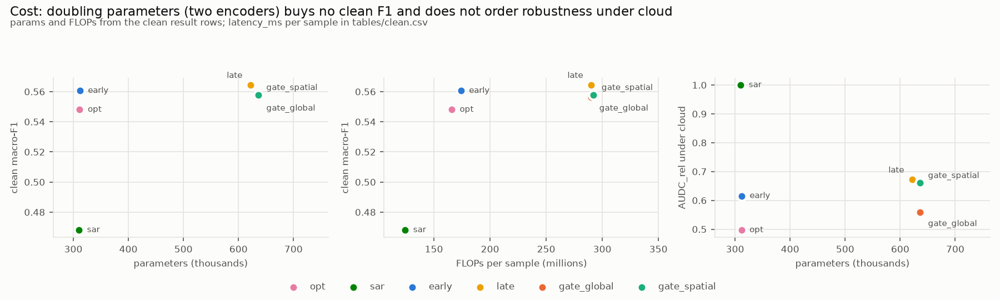

# Experiment 1, Stage 1 pilot: review

Results dir: `outputs/kaggle/petarzlomislic_diplomski/4ad1eb996202823b9115d8eff2496fdcc034c251/`
Plan: `docs/experiments/exp1-preanalysis.md`, `exp1-implementation.md`, `exp1-deviations.md`
Reviewed 2026-10-28. Every number below comes from `tables/`, `analysis/` or the run logs. Scripts are in `scripts/`.

## 1. Summary

- **What ran.** The full Stage 1 pilot ran to completion with no failures: 6 arms × seed 0, a width-16 CNN trained for 15 epochs on the 15% `reben-sweep` tier, then evaluated on the pilot grid. That gives 54 of 54 result rows. It was one Kaggle T4 session of 4.62 h at git SHA 4ad1eb9.
- **Can it be trusted?** Mostly, as a pipeline test. Leakage, row completeness, provenance and per-class checks PASS. Two pre-flight checks FAIL:
  - **data_wait.** Every arm spent 45-61% of each training step waiting for input.
  - **BIFOLD reference.** opt scored 0.548 against a reference of 0.644, and sar 0.468 against 0.566. Both are about 0.10 below, outside the 0.05 tolerance.

  The two tensor checks (identity at s=0, same seed giving the same corruption) were **not run**, because the test shards are not available locally. Stage 2 is therefore **NOT READY** under §8.
- **Clean.** Fusion does not beat optical. The four fusion arms score 0.556-0.564 macro-F1 against opt's 0.548, gaps of +0.008 to +0.016. Their validation ordering differs from their test ordering, which is consistent with H1. With one seed this is a description, not a verdict.
- **Under optical loss, the fusion arms fall far below SAR alone.** With optical dropped, late scores 0.378, gate_global 0.303, gate_spatial 0.284 and early 0.086, while sar alone scores 0.468. Under full cloud (all-zero optical, not masked), the gates fall to 0.059 and 0.133, and the gate weight does not move off the occluded optical stream. gate_global's weight actually rises from 0.63 to 0.75. **The gates are not doing what H3 assumes.** This matches the §5 "SAR branch undertrained" pattern that the plan answers with OGM-GE.
- **H4 is directionally as predicted, on one seed.** On AUDC_rel, gate_spatial beats gate_global under cloud (0.660 vs 0.558) and loses under speckle, drop_optical and drop_sar. However, gate_spatial's mean weight barely moves under cloud (0.63 to 0.61), so the logged diagnostics do not explain that advantage.
- **Decision this informs.** Whether to start Stage 2 as configured. The recommendation is not yet:
  - Fix the input pipeline first. At the pilot's throughput, Stage 2 projects to about 168 T4-hours.
  - Run the two skipped tensor checks.
  - Decide on the gate/SAR-branch problem. That is a design decision, see §7.
  - Resolve one analysis-code inconsistency: H3 is reported as "rejected" from a single seed.

## 2. What ran

| | |
|---|---|
| Experiment / stage | Exp 1, Stage 1 pilot (§8): `exp1_run` entry, `stage=pilot` |
| Arms | opt, sar, early, late, gate_global, gate_spatial |
| Seeds | 0 (one per arm); `degradation_seed` 12345 for all |
| Data | `peroz1/reben-sweep` (15% tier), 35,712 training samples/epoch (8,370 steps / 15 epochs × batch 64) |
| Model / schedule | `ConvEncoder` width 16, depth 4, random init (deviation 12); AdamW lr 1e-3, wd 0.01, cosine T_max 15, 15 epochs, batch 64, augment on; checkpoint = best validation macro-F1 (`ckpt_kind=best`), threshold 0.5 |
| Sweep grid | `configs/evaluate.yaml` `grids.pilot`: cloud {.5, 1}, speckle {.5, 1}, drop_optical {1}, drop_sar {1}, temporal {1, 8}; F1(0) = the clean row |
| Hardware | Kaggle T4, 4 vCPU, `data.num_workers=10` |
| Wall time | 16:52:46 to 21:29:53 UTC on 2026-10-27, 4.62 h. Breakdown: setup about 11 min (env build 3 min 41 s; dataset download 41.5 GB in 429 s), training 3.00 h, sweeps 1.43 h (`tables/provenance.csv`) |
| Git | 4ad1eb996202823b9115d8eff2496fdcc034c251, `git_dirty: false` in all 42 `run_start` events |
| Config hashes | opt e8829ce68496, sar b3a8509b468a, early 74ff6bfc2033, late d9156cfe6677, gate_global 8d1e76fca88c, gate_spatial 0cb645c9b3a3 |
| Run dirs | opt `20261027-170400-5721ea`, sar `-174759-881fb4`, early `-183137-7d55d3`, late `-191540-9e408f`, gate_global `-200007-c67fce`, gate_spatial `-204455-fd1ea3` |

**Deviations from the plan.**
- The plan's pilot budget was about 6 GPU-hours on A10G. The pilot used 4.62 h on a T4.
- `num_workers=10` overrides the experiment config's 4. That is an infrastructure knob, not logged in `exp1-deviations.md`, and it never touches arms differently.
- Training-schedule item 5 in `exp1-implementation.md` is still marked "Open". The pilot ran on those placeholders: lr 1e-3, batch 64, no warmup, no early stopping.
- The dataset was fetched from the HF Hub without a token (`hf_token_unavailable` in the kernel log), not through a Kaggle mirror. It cost about 7 min and had no effect on results.
- Everything else matches the plan and deviations 1-16.

## 3. Integrity checks

Source: `tables/integrity.csv` (computed by `scripts/tables.py`, using `src.preflight`'s own check functions where they need no data).

| Check | Status | Evidence |
|---|---|---|
| Every planned (arm, seed, degradation, severity) row present | **PASS** | 54 rows (54 raw, 0 duplicates) = 6 arms × (clean + 8 sweep points); none missing, none extra |
| One SHA / config per arm | **PASS** | single SHA 4ad1eb9; one run_id and one config_hash per arm; result rows match `run_config.yaml` |
| Severity 0 equals clean | **SKIP** | The pilot sweep does not repeat s=0 (deviation 5), so no result row exists to compare. The tensor-level check needs the test shards. Consistency evidence: cloud@1.0 and drop_optical give identical per-class F1 for opt and early, as they must, since both feed an all-zero optical input |
| No leakage (preflight 3) | **PASS** | 8/8 rows bit-equal to clean: opt under speckle, drop_sar and temporal; sar under cloud and drop_optical |
| Per-class F1 not all 0 (preflight 6) | **PASS** | No class is 0 in every arm. Classes at 0 per arm: Beaches, dunes, sands in 5/6 arms (all but gate_spatial, 0.065); Coastal wetlands in sar, gate_global and gate_spatial |
| data_wait_frac < 0.3 (preflight 5) | **FAIL** | Median over training heartbeats: opt 0.61, sar 0.59, early 0.59, late/gate_global/gate_spatial 0.47. `data_wait_high` fired on all 90 epochs. num_workers 10 on 4 vCPU (PyTorch warns "suggested max number of worker … is 4") |
| Clean F1 vs BIFOLD reference, tolerance 0.05 (preflight 4) | **FAIL** | opt 0.548 vs 0.644 (−0.096); sar 0.468 vs 0.566 (−0.098) |
| Failures / reruns in logs | **PASS** | `exp1_all_done failed=[]`; 0 `run_failed` or error events; 42 `run_end`, all `ok`; all 6 trainings `resumed_from: null`. The only warnings are litdata cache-size notices, worker-count notices and library deprecations |
| Preflight 1 identity / 2 seed (tensor checks) | **SKIP** | `uv run python -m src.preflight <dir> --ref opt=0.644 --ref sar=0.566` crashes before any check: `FileNotFoundError: …\data\peroz1\reben-sweep\manifest.json` (full traceback in `analysis/preflight.txt`). These checks must be run where the shards exist |

**Reading the two FAILs.**
- **data_wait.** This is an infrastructure fault, and it is real. Throughput is flat at about 400-455 samples/s for every arm, even though the two-encoder arms have about twice the FLOPs. The GPU waits on CPU decoding. The wait fraction is lower for the heavier arms, presumably because their compute share is larger; that part is inferred, not measured.
- **Reference.** This one is ambiguous. Both unimodal arms sit almost exactly 0.10 below their reference. That uniform gap is what a smaller model, 15 epochs and 15% of the data would produce, rather than a wiring bug. But a width-16 CNN is not the ResNet-18 the reference used, so the pilot cannot tell the two explanations apart (see §6).

## 4. Results

### 4.1 Clean performance


*What to look at: the four fusion bars are indistinguishable from opt on both metrics. The black ticks show how far opt and sar sit below the ResNet-18 references.*

| arm | macro-F1 | micro-F1 | best val macro-F1 | params | FLOPs/sample | latency ms/sample |
|---|---|---|---|---|---|---|
| opt | 0.548 | 0.711 | 0.568 | 311,571 | 166 M | 0.181 |
| sar | 0.468 | 0.642 | 0.464 | 310,131 | 124 M | 0.143 |
| early | 0.561 | 0.712 | 0.588 | 311,859 | 174 M | 0.182 |
| late | 0.564 | 0.714 | 0.588 | 621,704 | 290 M | 0.313 |
| gate_global | 0.556 | 0.719 | 0.599 | 635,829 | 290 M | 0.321 |
| gate_spatial | 0.558 | 0.717 | 0.594 | 635,829 | 292 M | 0.323 |

Source: `tables/clean.csv`. Validation and test pick different winners: gate_global is best on validation (0.599) but 4th of 4 fusion arms on test.

### 4.2 Degradation curves


*What to look at: in the cloud and drop_optical panels, every fusion line ends far below the flat sar line.*


*What to look at: sar collapses to R ≈ 0.02 already at speckle 0.5. temporal costs at most 15% for every fusion arm.*

Macro-F1 per point (`tables/degradation_f1_macro.csv`; micro-F1 in `degradation_f1_micro.csv`, R(s) in `degradation_retention.csv`):

| arm | clean | cloud .5 | cloud 1 | speckle .5 | speckle 1 | drop_opt | drop_sar | temporal 1 | temporal 8 |
|---|---|---|---|---|---|---|---|---|---|
| opt | 0.548 | 0.269 | 0.000 | 0.548 | 0.548 | 0.000 | 0.548 | 0.548 | 0.548 |
| sar | 0.468 | 0.468 | 0.468 | 0.010 | 0.010 | 0.468 | 0.022 | 0.427 | 0.356 |
| early | 0.561 | 0.388 | 0.086 | 0.543 | 0.479 | 0.086 | 0.338 | 0.525 | 0.496 |
| late | 0.564 | 0.401 | 0.172 | 0.377 | 0.312 | 0.378 | 0.457 | 0.526 | 0.483 |
| gate_global | 0.556 | 0.316 | 0.059 | 0.387 | 0.349 | 0.303 | 0.512 | 0.527 | 0.490 |
| gate_spatial | 0.558 | 0.414 | 0.133 | 0.435 | 0.178 | 0.284 | 0.486 | 0.527 | 0.486 |

Accuracy is not informative here. opt at cloud 1.0 has macro-F1 0 but accuracy 0.842, because it predicts all-negative on a sparse multi-label target. It is not used below.

### 4.3 Table 1: AUDC and AUDC_rel (`tables/table1.csv`, one seed, so no band)

| arm | cloud AUDC / rel | speckle | drop_optical | drop_sar | temporal |
|---|---|---|---|---|---|
| opt | 0.272 / 0.497 | 0.548 / 1.000 | 0.274 / 0.500 | 0.548 / 1.000 | 0.548 / 1.000 |
| sar | 0.468 / 1.000 | 0.163 / 0.347 | 0.468 / 1.000 | 0.245 / 0.523 | 0.417 / 0.891 |
| early | 0.345 / 0.615 | 0.528 / 0.941 | 0.323 / 0.577 | 0.449 / 0.801 | 0.527 / 0.940 |
| late | 0.379 / 0.672 | 0.418 / 0.741 | 0.471 / 0.835 | 0.511 / 0.905 | 0.525 / 0.930 |
| gate_global | 0.311 / 0.558 | 0.431 / 0.774 | 0.430 / 0.773 | 0.534 / 0.960 | 0.525 / 0.943 |
| gate_spatial | 0.368 / 0.660 | 0.390 / 0.699 | 0.421 / 0.755 | 0.522 / 0.936 | 0.523 / 0.938 |

Absolute vs relative orderings (`tables/orderings.csv`):
- **Agree:** under cloud, speckle and drop_sar.
- **Disagree:**
  - drop_optical: late and sar swap the top two places.
  - temporal: the four fusion arms reshuffle within an AUDC_rel range of 0.930-0.943.
  - `none`: flagged as disagreeing, but this is an artefact. All AUDC_rel = 1.0 there, so the tie order is arbitrary.

### 4.4 Table 2: hypotheses (`tables/table2_hypotheses.csv`, as produced by `src.analysis exp1`)

| H | scope | tool verdict | deciding numbers | review reading |
|---|---|---|---|---|
| H1 | clean macro-F1 | inconclusive | opt 0.548; fusion 0.556-0.564 | Consistent with H1. One seed |
| H2 | AUDC drop, cloud − speckle | inconclusive | early +0.183, late +0.039, gate_global +0.120, gate_spatial +0.022 | Direction as predicted for all four fusion arms. One seed |
| H3 | AUDC_rel under cloud | **rejected** | gate_global 0.558, gate_spatial 0.660, late 0.672, early 0.615 | **Should read inconclusive** under deviation 6 (see below). On point estimates, early > gate_global, and late is ahead of both gates |
| H3 | AUDC_rel under drop_optical | inconclusive | gate_global 0.773, gate_spatial 0.755, late 0.835, early 0.577 | Gates > early holds; gates > late fails on point estimates |
| H4 | spatial vs global, AUDC_rel | inconclusive | cloud 0.660 vs 0.558; speckle 0.699 vs 0.774; drop_optical 0.755 vs 0.773; drop_sar 0.936 vs 0.960 | Pattern as predicted (spatial wins under cloud only). One seed |
| H5 | \|Spearman(params, AUDC)\| < 0.8 | held | ρ: cloud −0.20, drop_optical 0.12, drop_sar 0.41, speckle −0.03, temporal −0.12 | Point estimate only. n = 6 configs with two parameter levels |
| H6 | AUDC_rel under temporal | inconclusive | early 0.940, gate_global 0.943, gate_spatial 0.938 | Consistent with H6 |

**Analysis-code inconsistency, which needs a decision.** Deviation 6 says: "Fewer than 2 seeds ⇒ 'inconclusive'. Makes every Stage 1 verdict inconclusive by design". `src/analysis.py:hypotheses` does not follow that for every hypothesis:
- **H3.** The rejection test is `v["early"].mean() >= v[g].mean()`, a point-estimate comparison with no seed requirement. That is why it prints "rejected" from one seed. It follows the §4 wording ("Rejected if early ≥ gate_*") literally, but it contradicts deviation 6.
- **H2.** The rejection branch is the same kind of test (`diff.mean() <= 0`). It did not trigger here.
- **H5.** It returns "held" from one seed.

`summary.txt` prints `configs separable beyond seed spread: None`, so the §5 hard-stop row cannot be evaluated either. I did not change the code.

### 4.5 Per-class F1


*What to look at: the two outlined rows. Beaches and Coastal wetlands are the only classes at 0, and no class is 0 in every arm. Permanent crops is at 0.02 for sar only.*


*What to look at: in the cloud@1 panel, the Urban fabric and water rows stay pale for late (urban −0.08, inland waters −0.09, marine −0.05). For gate_spatial only the urban rows stay pale (urban −0.05, inland waters −0.48). Every arm loses the forest and agriculture classes.*

### 4.6 Modality weights


*What to look at: under cloud, neither gate moves its weight toward SAR. Under speckle, gate_spatial moves its weight toward the corrupted SAR stream (optical 0.29 at s=1).*

From `tables/modality_weights.csv` (optical weight; SAR = 1 − optical):

| arm | clean | cloud .5 | cloud 1 | speckle .5 | speckle 1 | temporal 8 |
|---|---|---|---|---|---|---|
| late | 0.603 | 0.603 | 0.603 | 0.603 | 0.603 | 0.603 |
| gate_global | 0.628 | 0.665 | 0.754 | 0.709 | 0.697 | 0.627 |
| gate_spatial | 0.631 | 0.604 | 0.610 | 0.588 | 0.290 | 0.634 |

Under drop_optical and drop_sar, the weights are 0/1 by construction (the masked softmax), so they are not shown.

### 4.7 Training health


*What to look at: the right panel. Every epoch of every arm sits above the 0.3 limit, and throughput (middle) is the same for 0.31 M- and 0.64 M-parameter models.*

- Batch loss from training heartbeats falls from 0.24-0.29 at the first logged step to 0.15-0.22 at the last (`tables/train_loss.csv`), with no divergence or NaN.
- Heartbeat losses are single-batch samples, so they are too noisy to say whether training had converged at epoch 15.
- Per-epoch validation F1 is not logged, so no validation curve is drawn.
- Training throughput is 400-455 samples/s per epoch for all arms. The exception is opt's first two epochs, at 329 and 366, while the cache was cold (`tables/throughput.csv`).

### 4.8 Cost


*What to look at: the two-encoder arms (about 0.62-0.64 M params, 290 M FLOPs) score no higher on clean data than early (0.31 M, 174 M), and they do not line up on AUDC_rel under cloud.*

Latency per sample roughly doubles for the two-encoder arms: 0.31-0.32 ms against 0.18 ms (`tables/clean.csv`). gate_global and gate_spatial have identical parameter counts (635,829), which confirms the parameter matching of deviation 9.

## 5. Interpretation

**Measured.**
1. **Clean fusion adds at most 0.016 macro-F1 over opt.** On validation, the gap is larger (0.020-0.031) and orders the arms differently. Run-to-run noise is plausibly as large as the gaps, so the clean ranking among the fusion arms carries no information.
2. **Under total optical loss, every fusion arm is worse than training on SAR alone.** With dropped optical, late scores 0.378 and the gates 0.284-0.303, against 0.468 for sar. early (0.086) is barely above opt (0.000). The SAR pathway inside each fusion model is far weaker than a SAR-only model of the same size.
3. **A fully clouded optical input (all zeros) is not detected by either gate.**
   - gate_global raises its optical weight from 0.628 to 0.754, and its F1 falls to 0.059. The same model reaches 0.303 when the optical stream is masked out (drop_optical).
   - gate_spatial's mean weight is flat (0.631 to 0.610).
   - The cloud fill is the training mean (deviation 3), and the gates never saw occluded inputs during training.
4. **Speckle at s = 0.5 already destroys the SAR-only model** (0.010). That is worse than giving it no SAR at all (drop_sar 0.022). The pilot's speckle curve for sar is saturated at its first non-zero point.
5. **gate_spatial moves weight onto SAR as SAR gets noisier.** Its optical weight drops from 0.631 to 0.290 at speckle 1.0, and its F1 falls to 0.178, the worst of the fusion arms there. gate_global moves the right way, but only slightly (SAR weight 0.372 to 0.303).
6. **temporal is the mildest degradation for every fusion arm** (R(8) = 0.856-0.885), and the gates gain nothing there over early (AUDC_rel 0.938-0.943 vs 0.940). This is as H6 predicts.
7. **Under full cloud, late keeps the SAR-friendly classes** (urban −0.08, inland waters −0.09, marine waters −0.05). The other fusion arms lose most of them; gate_spatial keeps only urban and industrial.

**Inferred.**
- Points 2 and 3 together look like the plan's predicted "most-likely failure": modality imbalance leaves the SAR branch undertrained, and the gate has no training signal to learn reliability. The fixed-weight late arm comes out as the most robust fusion arm under optical loss. The likely reason is that it keeps a separate SAR head that is trained on its own logits.
- The H4 pattern (gate_spatial better than gate_global only under cloud) is in the predicted direction. However, the logged mean weight cannot show whether gate_spatial actually down-weights the clouded tokens. With one seed and a mechanism that is not visible in the diagnostics, this should be treated as unexplained, not as support for H4.

**Not shown.**
- Nothing here separates any two configs beyond seed spread; there is only one seed.
- The pilot does not show whether the 0.10 gap to BIFOLD is capacity or a bug.
- Whether gating would work if the gates were trained on degraded inputs is untested.

## 6. Caveats

- **One seed.** Every comparison is a point estimate. Under the pre-registered rule (deviation 6) every verdict is "inconclusive", including the tool's H3 "rejected" and H5 "held".
- **Small backbone, partial data, short schedule vs the reference.** Width 16, 15% data and 15 epochs, against BIFOLD's ResNet-18 on full data with 23-28 best epochs (per the implementation notes). The reference check is not a like-for-like comparison, so its FAIL does not separate "small model" from "bug".
- **Input-bound training.** 45-61% of each step was spent waiting for data. That does not bias the comparison, because all arms ran the same loader for the same number of steps, but it makes Stage 2 expensive (see §7).
- **The tensor-level identity and seed checks were never run** for this pilot. The s=0 identity rests on unit tests and the cloud@1 = drop_optical consistency only.
- **Saturated or coarse degradations.**
  - sar under speckle is at the floor from s = 0.5.
  - opt hits exactly 0 at cloud 1.0.
  - Three-point grids make AUDC sensitive to a single point.
  - temporal uses spatial neighbours as a stand-in for time (deviation 1), so it is a misalignment proxy.
- **Cloud = zero fill.** The cloud fill is the training mean, not a bright cloud signature (deviation 3). Gate behaviour under a realistic cloud signal could differ.
- **Modality weights are test-set means.** gate_spatial's per-token behaviour (the H4 mechanism) is not observable from the logged diagnostics.
- **Rare classes.** Beaches and Coastal wetlands are at 0 in most arms, so macro-F1 includes two near-dead classes, and small absolute swings in them move the macro average.

## 7. Recommendations

The decisions are the user's.

1. **Fix the input pipeline before Stage 2.** `num_workers=10` on a 4-vCPU host oversubscribes the CPU, and throughput does not scale with model cost. A rough projection from the pilot's measured wall times (`tables/stage2_projection.csv`; scales linearly in data, epochs and sweep points, and ignores width 32 vs 16):
   - about 6.7 h of training plus 2.6 h of sweep per run
   - **about 168 h** for 18 runs on this hardware

   Re-measure `data_wait_frac` with `num_workers=4` (the exp1 default) and/or pre-decoded shards before committing.
2. **Run preflight checks 1-2 where the test shards exist** (on a Kaggle/HF job): `python -m src.preflight <dir> --ref opt=0.644 --ref sar=0.566`. Stage 2 is gated on them (§8).
3. **Resolve the reference gap cheaply before 18 runs.** One option: train `opt` once with the Stage 2 config (width 32, 30 epochs, full tier), and check it lands within 0.05 of 0.644. If it is still about 0.10 short, suspect training (schedule item 5 is still open) before suspecting the arms.
4. **Decide what to do about the gates and the SAR branch (§5, "H1 holds AND H3 fails" row).** The pilot already shows:
   - fusion arms far below sar under optical loss
   - gates that do not react to an occluded stream

   Options the plan already names: OGM-GE, with both arms reported. A further option would be modality-dropout or corruption augmentation during training, so the gate sees unreliable inputs. That would be a new deviation and needs to be logged as one. Whatever is chosen should be decided **before** Stage 2, not after.
5. **Make the analysis honour deviation 6**: single-seed H3/H2 rejections and the H5 "held" should read "inconclusive". This is a small change in `src/analysis.py:hypotheses` and needs the user's go-ahead. Alternatively, amend deviation 6 to say that point-estimate rejections are allowed. Also, the `none` row in `orderings.csv` should not be flagged as a disagreement, since it is a tie artefact.
6. **Check the speckle mapping.** SAR-only collapses at L = 2 (s = 0.5), below its own drop_sar score. Verify the dB scaling against the band std, and consider whether the full grid's s = 0.25 (L = 4) still saturates. A saturated grid makes H2 and the speckle rankings uninformative.
7. **Log per-token gate maps (or the weight inside vs outside the cloud mask) for gate_spatial.** Without them, an H4 "held" in Stage 2 would have no mechanism behind it.

## 8. Reproduce

From the repo root (`C:\Users\zlomi\projects\robustness-eval`, Git Bash):

```bash
D=outputs/kaggle/petarzlomislic_diplomski/4ad1eb996202823b9115d8eff2496fdcc034c251
R=reports/exp1-pilot-2026-10-27
uv run python -m src.analysis aggregate $D --out $R/analysis/aggregate
uv run python -m src.analysis exp1 $D --out $R/analysis/exp1
uv run python -m src.preflight $D --ref opt=0.644 --ref sar=0.566 > $R/analysis/preflight.txt 2>&1  # needs test shards; crashes locally
uv run python $R/scripts/tables.py $D     # tables/*.csv + integrity checks (copies table1/table2/orderings)
uv run python $R/scripts/figures.py       # figures/*.png (copies fig1-3 from analysis/exp1)
```

The kernel log (`$D/kernel_log.json`, JSON from the first `[`) was used for wall time, setup, warnings and the `exp1_all_done` record.
